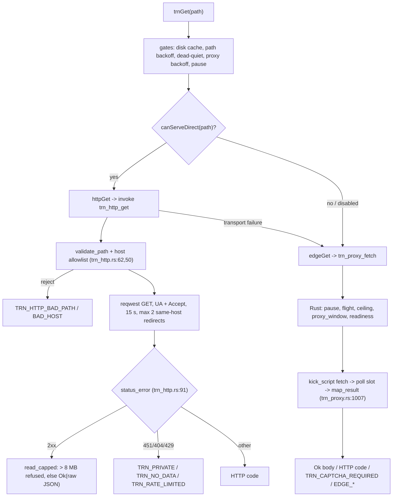

# Backend (Rust) architecture — modules, threads, commands, failure map

Read-only survey of `src-tauri/src` at `ac6a6de` (2026-11-09); line refs are current there. Scope:
the Rust process only. React half: [`frontend.md`](./frontend.md); measured process:
[`runtime.md`](./runtime.md).
## 1. Module map

| file | responsibility | commands | threads | windows |
|---|---|---|---|---|
| `main.rs` (17) | entry; AppUserModelID; `WEBVIEW2_ADDITIONAL_BROWSER_ARGS` (`:12-17`) → `run()` | — | — | — |
| `lib.rs` (1598) | builder/plugins, `setup`, tray, window floor, daemons, 64 commands | 64 | 4 persistent + 3 one-shot | main, overlay, dev; reads all |
| `window_manager.rs` (941) | Win32 classes/styles, Valorant window+rect, overlay subclass/click-through, Tab state | — | 1 resize nudge (`:337`) | overlay + game HWND |
| `display.rs` (2822) | display modes/CCD, GPU scaling, hotkey model + poller | — | 1 poller (`:936`, 30 ms) | — |
| `tracker.rs` (664) + `riot_http.rs` (308) | Riot local + remote HTTP (native-tls = Schannel) | 11 | `spawn_blocking` only | — |
| `accounts.rs` (1079) | Riot account vault: snapshot, switch, kill/relaunch | 10 | `spawn_blocking` only | — |
| `trn_proxy.rs` (2417) | hidden-WebView2 TRN transport, Warden flow, ceiling/memo/flight | 7 | 1 async task (`:730`, 60 s idle teardown) | `trn-proxy`, `trn-verify` |
| `trn_http.rs` (263) | direct `api.tracker.network` transport (reqwest/rustls) | 1 | `spawn_blocking` only | — |
| `trn_cache.rs` (1263) | on-disk TRN response cache + pruner | 6 | — | — |
| `perf.rs` (1209) / `space_spam.rs` (212) | process sampling / Space hold-to-repress | 1 each | — / 2 (`:30` hook, `:59` injector) | — |
| `custom_res/` (mod 522 / timing 584 / edid 109), `gpu.rs` (1099), `game_config.rs` (899), `calculator.rs` (229) | CRU/EDID, GPU, VALORANT ini, stretch math — helpers only; `timing.rs` + `edid.rs` are pure and tested on Linux, `mod.rs` keeps the registry/SetupAPI writes | — | — | — |
| `paths.rs`, `settings.rs`, `shortcuts.rs`, `updater.rs`, `webview_guard.rs` | data dirs/migration, `settings.json`, quick shortcuts, updater wiring, WebView2 presence gate | — | plugin/1-shot | — |

## 2. Command surface — 101 commands, 8 modules

| module | n | commands (grouped) | TS callers |
|---|---|---|---|
| `lib.rs` | 64 | window (6), display/resolution (8), GPU (7), borderless (2), overlay (10), VALORANT config (8), shortcuts/update/autostart (10), monitors (9), CRU/EDID (7), misc (2) | `utils/ipc.ts` (bulk), `App.tsx`, `AppSettingsView`, `Overview`, `UnifiedStretch`, `HardwareScaling`, DevDashboard |
| `tracker.rs` | 11 | `is_riot_client_running`, `local_{request,presences,entitlements,client_version}`, `detect_local_account`, `riot_local_namesets`, `riot_direct_{get,post,put}`, `riot_resolve_names` | `utils/tracker.ts`, `utils/ipc.ts` |
| `accounts.rs` | 10 | `accounts_{list,current,auto_tick,add_new,remove,get_auto_start,set_auto_start}`, `account_{switch,save_current,launch_client}` | `AccountsView`, `utils/ipc.ts` |
| `trn_proxy.rs` | 7 | `trn_proxy_{fetch,paused,state,reset}`, `trn_verify_open`, `trn_warden_token`, `trn_trace_log` | `utils/trn.ts`, DevDashboard |
| `trn_cache.rs` | 6 | `trn_cache_{read,get,write,put,stats,trace_log}` | `utils/trn.ts`, `scripts/trn-cache-check.ts` |
| `perf.rs` / `space_spam.rs` / `trn_http.rs` | 1 each | `perf_poll`, `set_space_spam`, `trn_http_get` | DevDashboard, `utils/ipc.ts`, `utils/trn.ts:271` |

**Unused (17, registered but no TS reference):** `account_save_current`, `account_launch_client`,
`apply_custom_res_to_all_configs`, `set_overlay_clickthrough`, `update_valorant_config`,
`get_quick_shortcuts`, `set_monitor_attached`, `set_monitor_primary`, `launch_cru`,
`restart_graphics_driver`, `reset_all_cru_overrides`, `reset_all_edid_overrides`,
`test_custom_mode`, `trn_cache_read`, `trn_cache_write`, `trn_cache_stats`, `trn_warden_token`.


**Duplicated / aliased:** `trn_cache_get`≡`trn_cache_read`, `trn_cache_put`≡`trn_cache_write`;
`set_overlay_clickthrough` duplicates `set_overlay_edit_mode(false)`'s exit branch; three
VALORANT config readers + two writers; `local_request` overlaps the typed `local_*` wrappers.

## 3. Threads and lifetimes

| thread / task | started | cadence | stops | failure mode |
|---|---|---|---|---|
| Tauri event loop | `Builder::run` | — | process exit | a `?` in startup exits the process |
| hotkey receiver | `lib.rs:1082` (`rx.recv()`) | event | sender dropped (never) | blocks forever, no timeout |
| display hotkey poller | `display.rs:936` | 30 ms | `running` flag never cleared | polls `GetAsyncKeyState` forever |
| space hook + injector | `space_spam.rs:30`, `:59` | hook / 15-50 ms | process exit | hook error → eprintln + return; toggle dead silently |
| overlay guard | `lib.rs:1295` | 100 ms | process exit | Ctrl+Shift+H exit, 90 s edit watchdog, Tab peek; a panic kills only this thread |
| auto-overlay daemon | `lib.rs:1181` | 2 s | process exit | errors logged, loop continues |
| auto-borderless daemon | `lib.rs:1113` | 1.5 s | process exit | errors logged |
| one-shots | `lib.rs:1019` (GPU purge), `window_manager.rs:337` (400/1000 ms nudge), `lib.rs:1454`/`:1099` (300 ms trim) | once | return | results ignored |
| single-instance | `lib.rs:1043` (plugin) | event | process exit | second launch focuses `main` |
| MCP bridge | `lib.rs:1038` (plugin) | HTTP server | process exit | loopback-only, **no auth**; can eval JS / invoke commands |
| updater | `lib.rs:1032` (plugin) | own runtime | process exit | install blocked mid-match by TS |
| TRN idle teardown | `trn_proxy.rs:730` (`async_runtime::spawn`) | 60 s | fires once | no-op if in-flight |
| tokio blocking pool | each `spawn_blocking` command | per call | task end | panic → `Task failed: …` |

## 4. Failure map — what broke, where, fix

**a. Riot error parsed as data** (`6757061`). `assertRiotOk` (`src/utils/tracker.ts:694`) throws on
`errorCode` / `httpStatus >= 400`, but it is called at only 3 of 18 `await riotGet(` sites — a 403
`SCHEDULED_DOWNTIME` body parses as "no rank, no games" and can overwrite the last-known-good
snapshot. The Rust half has the same hole: `riot_direct_get_blocking` (`tracker.rs:540-568`) checks
only `is_auth_failure` and returns every other Riot error envelope as `Ok(body)`.
**Structural fix:** enforce at the choke point — reject `httpStatus >= 400 || errorCode` inside
`riotGet` (TS) and inside `riot_direct_get_blocking` (Rust, `Err("RIOT_HTTP <status>")`) — then the
per-site asserts disappear.

**b. Window creation aborting startup** (`a1b7ef9`). Tauri's startup loop runs `.build()?` on every
`tauri.conf.json` window before `setup`; the overlay was one, so one failed webview killed the
process with zero windows and no dialog. **Shipped fix:** overlay is `"create": false` and built by
`build_overlay_window` (`lib.rs:973`), whose error is non-fatal — log +
`show_message_box(overlay_unavailable_message(..))` (`lib.rs:953`) and the app runs without a HUD.
**Structure:** optional surfaces are never config windows; boot stays infallible.

**c. Webview gate applied to a non-webview transport** (`db54d2a`). `trnGet` refused every request
on `trnProxyPaused()` — a webview-only concern (the hidden window must not evaluate JS while
VALORANT owns the screen) — so the direct reqwest transport was refused mid-match and the live
board sat empty. **Shipped fix:** transport-aware gate, `canServeDirect` (`trn.ts:200`) bypasses it
at `trn.ts:1027`. **Residual (same anti-pattern):** edge-only breakers still gate every transport —
`isTrnDeadQuiet()` (`trn.ts:1002`) and `trnProxyBackoffRemainingMs()` (`:1012`) are fed by EDGE
outcomes but checked before transport selection. Move both inside `edgeGet`.

## 5. Slop / structural debt

- **Size:** 7 of 21 modules >1000 lines (`display` 2822, `trn_proxy` 2417, `lib` 1598,
  `trn_cache` 1263, `perf` 1209, `gpu` 1099, `accounts` 1079) — 11.5k/17.4k.
  `lib.rs` registers 64 of 101 commands.
- **Dead surface:** the 17 registered-but-uncalled commands above; no unregistered handlers.
- **Logging is a no-op:** `tauri-plugin-log = "2"` is in `Cargo.toml` but never registered in the
  builder, so every `log::warn!/info!` goes nowhere (TRN works around it with `trn_trace!`).
- **Global state:** ~20 process-wide atomics/mutexes (`OVERLAY_EDIT_MODE`, `OVERLAY_PRESENT`,
  `TRN_CEILING`, `TRN_MEMO`, `TRN_FLIGHTS`, `PROXY_*`) — needed for two webview realms, hard to test.
- **Portability noise + shell-outs:** `#[cfg(windows)]` / `#[cfg(not(windows))]` stubs in a
  Windows-only crate (`webview_guard.rs:108-119`, `is_tab_down`); `accounts::process_running` runs
  `tasklist` per check, and the CRU helpers shell out too.
- **Security:** MCP bridge is loopback-only but unauthenticated by design.

## 6. App start

```mermaid
sequenceDiagram
  participant OS
  participant M as main.rs
  participant R as app_lib::run()
  participant T as Tauri builder
  participant S as setup()
  participant D as daemon threads
  OS->>M: main()
  M->>M: AppUserModelID + WEBVIEW2_ADDITIONAL_BROWSER_ARGS
  M->>R: run()
  R->>R: webview_guard::ensure_webview2_or_exit (exit 3 if missing)
  R->>R: paths::migrate_legacy_data
  R->>R: display::start_hotkey_listener -> 30 ms poller
  T->>T: build config windows (main only; overlay create=false)
  Note over T: a config-window build failure aborts here, before setup
  T->>S: setup(app)
  S->>S: tray + main-window floor + --minimized hide
  S->>S: build_overlay_window (non-fatal) + build_dev_window (dev only)
  S->>D: purge + hotkey rx + auto-borderless 1.5 s + overlay 2 s + guard 100 ms
  S-->>T: Ok(())
  T->>OS: event loop + main webview loads dist/index.html
```

## 7. TRN request path


