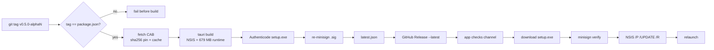

# Build, bundle and update chain (rewrite basis)

From `git tag` to a user restarting on a new build, as of v0.5.0-alpha22.
Evidence: the workflows, `tauri.conf.json`, `updater.rs`, `fetch-webview2.mjs`,
`hooks.nsh`, and Actions runs 42545702186 (alpha17) / 42663086991 (alpha22).

## 1. Pipeline

| Workflow | Trigger | Produces |
| --- | --- | --- |
| `release.yml` | push tag `v*`; `workflow_dispatch` on a tag ref | Release: setup.exe + `.sig` + `latest.json` |
| `build-windows.yml` | push `fix/**`; `workflow_dispatch` | exe artifact + tests; fetches the runtime, no zip |
| `deploy-website.yml` | push `main` under `website/**` | marketing site only — not in the app chain |

Release steps (alpha17 ~13 min total; alpha9 ~15 min):

| Step | alpha17 | alpha9 | Notes |
| --- | --- | --- | --- |
| validate tag / version / secrets | 10 s | 3 s | tag must equal `package.json`; fails before building |
| fetch WebView2 CAB | 7 s | 9 s | 310 MB CAB, sha256-pinned; no cache (tag scopes never hit, see risks) |
| build signed bundle | **702 s** | **833 s** | dominant: Rust release + NSIS/LZMA over the 679 MB runtime |
| Authenticode setup.exe | 3 s | 3 s | self-signed PFX from `WINDOWS_SIGN_PFX_*` |
| refresh updater `.sig` | 1 s | 1 s | re-minisign after Authenticode changed the bytes |
| latest.json + publish | 17 s | 15 s | `gh release create --latest` |

The release path also runs `cargo test --lib` after the runtime fetch and before
the bundle. It costs one test-profile build per release (tag-scoped rust-cache means
it is not free on every tag); the timings above predate it.

`build-windows.yml` stops at the bare exe. It fetches the runtime first, because
tauri-build validates `bundle.resources` even for tests and `--no-bundle`, then
runs frontend, `cargo test --lib`, the build, Authenticode, and uploads one
artifact (`recon-windows-x64`, 7 days). No portable zip.

Two lessons from the 2026-11-10 red run:
- `tauri-build` validates `bundle.resources` at compile time: `cargo test`,
  `cargo check` and `--no-bundle` all need `webview2-runtime/` on disk.
- A workflow simplification is proven only by a dispatched run on its branch.
  The 10-step branch CI read correctly and could not compile the crate.
- `cargo check`/`cargo build` never compile `#[cfg(test)]` code: a module split is
  not verified until `cargo test --lib` (or `--tests`) is green. The lib check is
  not the test check.
- Run that check in the **debug** profile. A `--release` check skips every
  `#[cfg(debug_assertions)]` block, and on 2026-11-10 all 59 compile errors lived
  exactly there (perf sampler statics, the trn trace rings).

## 2. Artifacts

| Artifact | Size (alpha17) | Signed how | Who gets it |
| --- | --- | --- | --- |
| `Recon_<v>_x64-setup.exe` | 253,031,136 B (241 MiB) | Authenticode + minisign `.sig` | every installed user, via the updater |
| `...setup.exe.sig` | 424 B | minisign, pubkey `77FD5160E2EB15E6` | source of the manifest signature |
| `latest.json` | 1,206 B | carries that signature | app update check |
| `recon-windows-x64` (artifact) | ~22 MB zipped exe | Authenticode, skipped without secrets | branch CI / manual testing |

## 3. Bundle contents — why 253 MB

- WebView2 fixed runtime **157.0.4341.42**, Microsoft's official CAB: 310,801,569 B
  pinned by sha256, 257 files / **679 MB unpacked** (`msedge.dll` alone: 357 MB).
- `webviewInstallMode: fixedRuntime` at `webview2-runtime` makes Tauri set
  `WEBVIEW2_BROWSER_EXECUTABLE_FOLDER = <exe dir>\webview2-runtime`; **no fallback**,
  so the folder must sit next to `recon.exe`.
- tauri-bundler 2.10.4 has **no NSIS arm for fixedRuntime**; the folder ships via
  `bundle.resources: ["webview2-runtime/"]` → `$INSTDIR\webview2-runtime`. Both
  halves matter: config alone ships nothing, resources alone are never pointed at.
- NSIS compresses that payload with LZMA: 679 MB → ~253 MB installer.
- Hooks (`hooks.nsh`): uninstall clears the remembered dir
  (`HKCU\Software\Youssef Adel\Recon`) unless `/UPDATE`; install falls back to the
  default location when the remembered dir holds no `recon.exe`.

## 4. Updater chain

- Manifest: `latest.json` → `platforms.windows-x86_64.{signature,url}`; the signature
  is minisign over the **final** (Authenticode-signed) exe. Re-signing after signing
  is load-bearing; the reverse order invalidates every download.
- The plugin verifies the manifest against `plugins.updater.pubkey`, downloads the
  exe, verifies it, ShellExecutes it with `/P /UPDATE /R /ARGS ...`; the app exits and
  the installer relaunches it.
- Channels: *stable* reads `/releases/latest/download/latest.json`. *early-access*
  queries the unauthenticated GitHub API (list `per_page=10` **and**
  `releases/latest`), keeps releases carrying `latest.json`, and takes the **highest
  semver** — never list order. Measured staleness: alpha10 was missing from the list
  while alpha9 led it, so order-based picking offered a downgrade.
- Comparator: strictly newer only, natural prerelease ordering (`alpha9 < alpha10 <
  alpha11`; `0.5.0 > 0.5.0-alpha14`). The old `!=` rule offered any different version,
  including older ones.
- No download timeout is configured (plugin default), so 253 MB on a slow line is
  safe; the only 4 s cap is the unauth releases-API call. Automatic installs also
  block during a live match or visible overlay.

## 5. Risks

- **CAB download**: one 310 MB stream from Microsoft's CDN, no retry in the script; a
  hiccup fails the release before build. The URL embeds a GUID path, so a Microsoft
  republish needs a script bump.
- **CAB cache removed**: `actions/cache` scope is the tag ref (API: every tag owns
  its own `refs/…/tags/vX` entry), so alpha17 and alpha18 both logged
  `Cache not found` while storing 310 MB each. The 7 s download is cheaper.
- **Unauth GitHub API**: 60 req/h per IP (shared NAT can exhaust it), 4 s timeouts,
  responses can lag or shuffle. Failure falls back to the floating `alpha` ref
  (usually 404), then to the plugin's configured `releases/latest` endpoint.
- **Retention**: branch artifacts expire in 7 days; release assets do not. Deleting a
  release breaks `/releases/latest` for everyone still on an older build.
- **Failed release, user side**: the job fails before publish, so users see no new
  version. A partial publish makes the check fail; the app keeps the working build.
- **Release path and tests**: until 2026-11-10 `release.yml` never ran `cargo test`,
  so alpha22 shipped with 69 test-target compile errors that only branch CI would
  have shown. Release now runs `cargo test --lib` before bundling; keep it there.
- **Self-signed Authenticode**: machines without the certificate still see
  SmartScreen on a manual download; the updater path does not surface it.

## 6. Proposed simplification for the redraw

- **Portable zip and CAB cache are gone** (done): the tester-only 300 MB artifact is
  dropped and the dead cache step removed; the runtime and signature chain stay.
- **A single reusable workflow was evaluated and rejected.** A called workflow runs
  as a separate job on another runner, so it cannot share a checkout; merging means
  conditional steps in one job, where branch CI and release differ in permissions
  (read vs write), secrets, artifacts and failure modes. Gating publish behind `if:`
  makes the tag → publish path harder to audit and risks publishing from a branch.
- **Keep, no substitutes**: tag/version guard; CAB pin + sha256 + cache; fixed runtime
  via `bundle.resources`; Authenticode then re-minisign order; `latest.json`; the
  semver picker/comparator; the NSIS hooks; `cargo test --lib` before bundling.
- **Do not drop the runtime to save build time.** The 253 MB installer is the product
  decision; cheaper NSIS compression would trade ~4 min of CI for a bigger download
  for every user.
