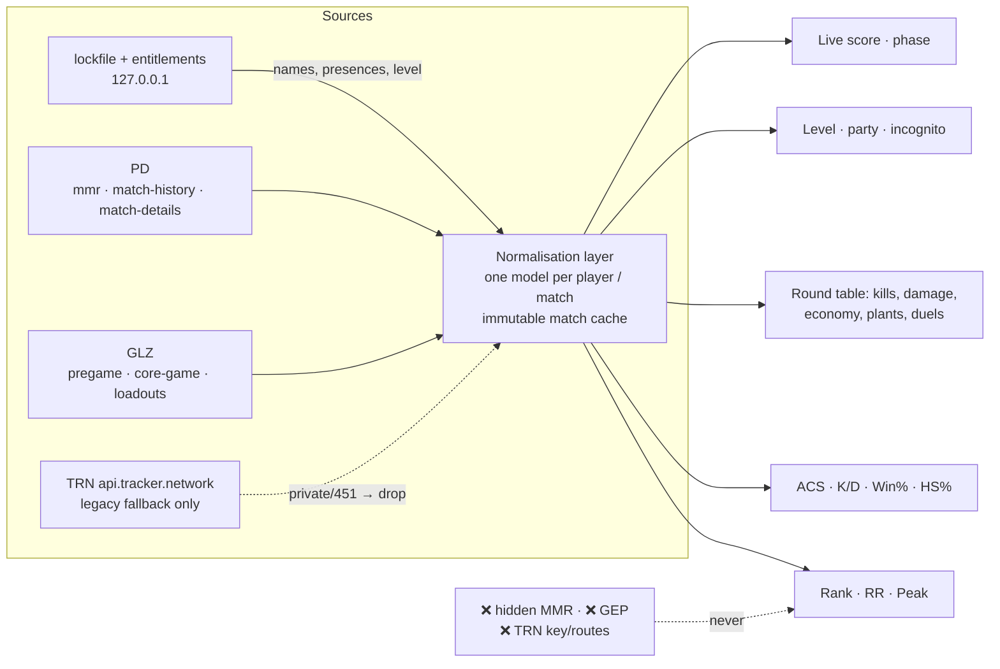

# Data sources and capability matrix (rewrite basis)

What Recon can read, what each source is good for, and what to build on.
Evidence: `docs/trn-re/` (TRN app RE), `docs/overwolf/webview2-runtime.md`,
`docs/upstream/` (TRN wall + data-source probes), code refs in `src/utils/tracker.ts`.

## 1. Riot local client — authoritative

Auth: `Riot Client\Config\lockfile` (port/password) for the loopback API;
`/entitlements/v1/token` for `Authorization: Bearer` + `X-Riot-Entitlements-JWT`;
`ShooterGame.log` for `X-Riot-ClientVersion` and `glz-{region}-1.{shard}`.
`X-Riot-ClientPlatform` is the standard base64 PC blob.

| Endpoint | Returns | Scope | During coregame |
| --- | --- | --- | --- |
| `GET 127.0.0.1:{port}/player-account/aliases/v1/active` | own game_name / tag_line / puuid | self | ✅ |
| `GET /entitlements/v1/token` | accessToken, entitlements JWT, subject | self (auth) | ✅ |
| `POST /player-account/lookup/v2/namesets-for-puuids` | Riot IDs for arbitrary PUUIDs, batched 25 | any | ✅ |
| `GET /chat/v4/presences` | presences; base64 `private` = live map, score, queue, `sessionLoopState`; partyId | all friends/party | ✅ **live score source** |
| `GET /chat/v1/session`, `/chat/v6|v7/*`, `/social/v1|v2/*` | region, conversations, social graph | self/all | ✅ |
| `GET pd.{shard}/mmr/v1/players/{puuid}` | tier, RR, peak + per-season `SeasonalInfoBySeasonID`, `LatestCompetitiveUpdate` | **any puuid** (verified) | ✅ |
| `GET pd.{shard}/mmr/v1/players/{puuid}/competitiveupdates` | last ~20 RR deltas | any | ✅ |
| `GET pd.{shard}/match-history/v1/history/{puuid}` | match list (`~95` window; excludes the live match) | any | ✅ |
| `GET pd.{shard}/match-details/v1/matches/{id}` | full round data (§4) | **any matchId** | ❌ current match not available until it ends |
| `GET glz-…/pregame/v1/players/{puuid}` | current pregame matchId | self | ❌ 404 (no pregame) |
| `GET glz-…/pregame/v1/matches/{id}` | agent-select lobby: PlayerIdentity (level, incognito, card), partyId, agent | match | ❌ 404 |
| `GET glz-…/core-game/v1/players/{puuid}` | current coregame matchId | self | ✅ |
| `GET glz-…/core-game/v1/matches/{id}` | live lobby: PlayerIdentity, partyId, team, character | match | ✅ |
| `GET glz-…/{pregame\|core-game}/v1/matches/{id}/loadouts` | per-player weapon loadouts | match | phase-scoped: wrong namespace **404s** |
| `GET pd.{shard}/personalization/v1|v2/players/{puuid}/playerloadout` | — | — | ❌ removed by Riot (404) |

Notes: Riot 4xx bodies are `{httpStatus, errorCode, message}` — Recon's `assertRiotOk`
throws instead of parsing them as empty data. Rank for lobby players is always
`mmr/v1/players/{puuid}` (GLZ match payloads do not carry rank badges). `pregame` and
`core-game` match IDs are different namespaces: each 404s on the other route.

## 2. Tracker Network — secondary, legacy

| Route | Params / notes |
| --- | --- |
| `GET api.tracker.network/api/v2/valorant/standard/profile/{platform}/{name}%23{tag}` | **`?source=overwolf-2`** (app) vs `source=web` (site); segments + metadata |
| `GET …/api/v2/valorant/standard/matches/{matchId}` | match detail, segment model (§4) |
| `GET …/api/v2/valorant/standard/matches/{platform}/{name}%23{tag}?type={playlist}` | match list; app adds `source=overwolf-2` |
| `…/api/v1/valorant/{insights,db/seasons,guides,premier/roster,privacy,overwolf/ow-bulk-lookup}` | private/undocumented — do not use |

Semantics (from the shipped app + our probes):
- **`metadata.privacy`** ∈ `public`, `ranked`; anything else means private — the app
  returns `{isPrivate:true}` and stops rendering stats.
- **404 vs 451**: `404` = no tracker page / never indexed → terminal *missing* (neutral);
  `451` = profile private → terminal *private*. Recon maps both into a negative registry
  (7 d private, 24 h missing) and never retries them (`src/utils/trn.ts:164-168, 455-520`).
- **`TRN-API-Key` is decorative; the UA is the gate.** The key is hardcoded in TRN's
  shipped package and requests are accepted based on the Overwolf client fingerprint
  (UA/origin), not the key. Never use or ship that key.
- Browser traffic hits a **Warden captcha** (`429 {"code":"Warden::Challenge"}`); it does
  not clear with backoff and needs a human — never put it on a retry loop
  (`docs/tracker-gg-postmortem.md`).

## 3. Capability matrix — what the rewrite can show

Legend: ✅ direct field · ⚙ computed from raw fields · ❌ unavailable.

| UI field | Riot local | TRN | Authoritative source | Notes |
| --- | --- | --- | --- | --- |
| Rank (tier) | ✅ `mmr` any puuid | ✅ profile | **Riot** | GLZ lobby has no rank |
| RR | ✅ current-season `RankedRating` | ✅ | **Riot** | per-season too |
| Peak rank | ✅ max `CompetitiveTier` over seasons | ✅ | **Riot** | any puuid |
| Act games / W-L / win % | ⚙ `mmr` games+wins or `roundResults` | ✅ | **Riot-computed** | |
| ACS | ⚙ `score / roundsPlayed` per match | ✅ precomputed | **Riot-computed** | |
| K/D | ⚙ `kills / deaths` | ✅ | **Riot-computed** | 0 deaths → null, never fake |
| HS % | ⚙ `damage[]` headshots / all hits | ✅ | **Riot-computed** | per-round too |
| Account level | ✅ `PlayerIdentity.AccountLevel` | ✅ bulk | **Riot** | live phases only |
| Round data (kills/damage/economy) | ✅ `roundResults[]` | ✅ segments | **Riot** | see §4 |
| Plants / defuses | ✅ per round (`bombPlanter`, `plantSite`, `plantRoundTime`, `defuseRoundTime`) | ❌ per round; aggregate only | **Riot** | local is *richer* |
| Live score / round / phase | ✅ presences + GLZ core-game | ❌ | **Riot** | GEP would too (not allowed) |
| Hidden / raw MMR | ❌ | ❌ | — | **never claim it** |

## 4. Per-round verdict (restated)

Local `match-details/v1/matches/{id}` is **sufficient and richer than TRN**. It carries
`roundResults[]` with round result/ceremony/winning team, `bombPlanter`/`bombDefuser`/
`plantSite`/`plantRoundTime`/`defuseRoundTime`/locations, and per player
`kills[]` (gameTime, roundTime, killer, victim, victimLocation, assistants, playerLocations,
finishingDamage), `damage[]` (headshots/bodyshots/legshots), `economy` (loadoutValue,
remaining, weapon, armor), plus `playerEconomies[]`/`playerScores[]` and a top-level
`kills[]`. TRN's `player-round` / `round-summary` / `player-round-damage` /
`player-round-kills` segments are a normalisation of exactly this; its extras (duels,
kill distance `sqrt(Δx²+Δy²)×0.01`) are computable. Recon already parses rounds/kills;
the missing counters and economy are in the same payload. Fetch once, cache immutably.

## 5. Do not use

- **TRN's hardcoded `TRN-API-Key`** — never call with it, never ship it.
- **TRN private routes** — `ow-bulk-lookup`, `insights`, `privacy`, `premier/roster`,
  `realtime-events` Socket.IO topics.
- **GEP (`overwolf.games.events`)** — needs an approved Overwolf app + Riot approval;
  not available to a Tauri app, and its use from outside Overwolf is a ToS breach.
- **tracker.gg web endpoints** — Warden captcha, scraping forbidden.
- **Hidden MMR** — no source; the UI must never display it.

