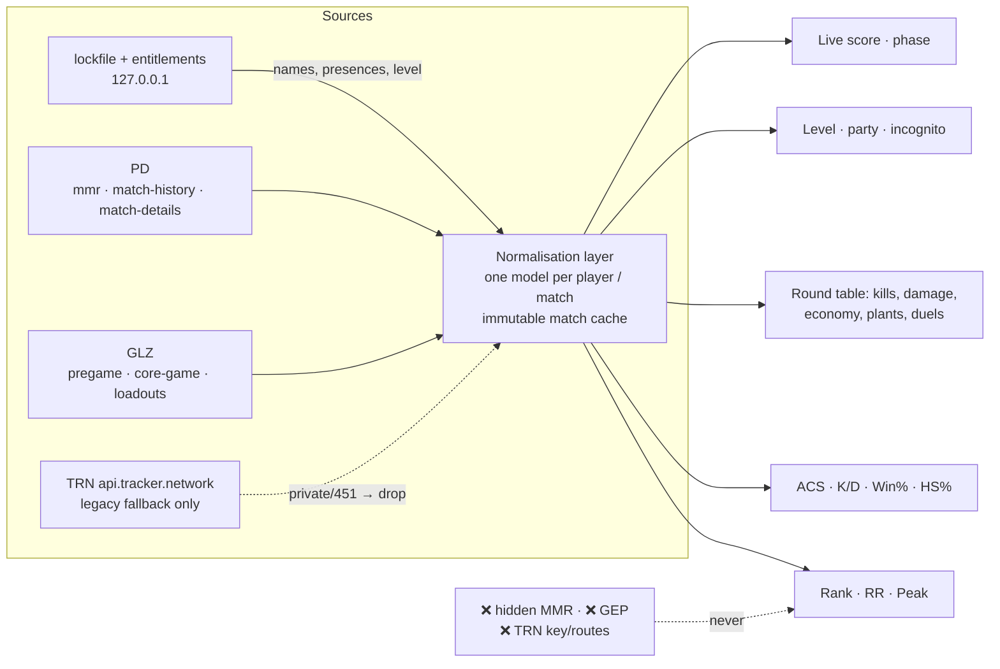

# Data sources and capability matrix (rewrite basis)

What Recon can read, what each source is good for, and what to build on.
Evidence: `docs/trn-re/` (TRN app RE), `docs/overwolf/webview2-runtime.md`,
`docs/upstream/` (TRN wall + data-source probes), code refs in `src/sources/riot.ts` (readers/transport) and `src/utils/tracker.ts` (orchestration).

## 1. Riot local client — authoritative

Auth: `Riot Client\Config\lockfile` (port/password) for the loopback API;
`/entitlements/v1/token` for `Authorization: Bearer` + `X-Riot-Entitlements-JWT`;
`ShooterGame.log` for `X-Riot-ClientVersion` and `glz-{region}-1.{shard}`.
`X-Riot-ClientPlatform` is the standard base64 PC blob.

| Endpoint | Returns | Scope | During coregame |
| --- | --- | --- | --- |
| `GET 127.0.0.1:{port}/player-account/aliases/v1/active` | own game_name / tag_line / puuid | self | ✅ |
| `GET /entitlements/v1/token` | accessToken, entitlements JWT, subject | self (auth) | ✅ |
| `POST /player-account/lookup/v2/namesets-for-puuids` | Riot IDs for arbitrary PUUIDs, batched 25 | any | ✅ |
| `GET /chat/v4/presences` | presences; base64 `private` = live map, score, queue, `sessionLoopState`; partyId | all friends/party | ✅ **live score source** |
| `GET /chat/v4/{presences,friends,friendrequests,blocked}`, `/chat/v5/participants`, `/chat/v6/{conversations,conversations/read,friendrequests/full,messages}` | conversations, social graph (region comes from the entitlements JWT, not chat) | self/all | ✅ |
| `PUT /name-service/v2/players` (JSON body, batched PUUIDs) | Riot ID for arbitrary PUUIDs — `riot_resolve_names` | any | ✅ |
| `POST pd.{shard}/store/v3/storefront/{puuid}` | shop (read-shaped POST) — `readStorefront` | self | ✅ |
| `GET pd.{shard}/mmr/v1/players/{puuid}` | tier, RR, peak + per-season `SeasonalInfoBySeasonID`, `LatestCompetitiveUpdate` | **any puuid** (verified) | ✅ |
| `GET pd.{shard}/mmr/v1/players/{puuid}/competitiveupdates` | last ~20 RR deltas | any | ✅ |
| `GET pd.{shard}/match-history/v1/history/{puuid}` | match list (`~95` window; excludes the live match) | any | ✅ |
| `GET pd.{shard}/match-details/v1/matches/{id}` | full round data (§4) | **any matchId** | ❌ current match not available until it ends |
| `GET glz-…/pregame/v1/players/{puuid}` | current pregame matchId | self | ❌ 404 (no pregame) |
| `GET glz-…/pregame/v1/matches/{id}` | agent-select lobby: PlayerIdentity (level, incognito, card), partyId, agent | match | ❌ 404 |
| `GET glz-…/core-game/v1/players/{puuid}` | current coregame matchId | self | ✅ |
| `GET glz-…/core-game/v1/matches/{id}` | live lobby: PlayerIdentity, partyId, team, character | match | ✅ |
| `GET glz-…/{pregame\|core-game}/v1/matches/{id}/loadouts` | per-player weapon loadouts | match | phase-scoped: wrong namespace **404s** |
| `GET pd.{shard}/personalization/v1|v2/players/{puuid}/playerloadout` | — | — | ❌ removed by Riot (404) |

Notes: Riot 4xx bodies are `{httpStatus, errorCode, message}` — Recon's `assertRiotOk`
throws instead of parsing them as empty data. Rank for lobby players is always
`mmr/v1/players/{puuid}` (GLZ match payloads do not carry rank badges). `pregame` and
`core-game` match IDs are different namespaces: each 404s on the other route.

## 2. Tracker Network — secondary, legacy

### Transport: direct Rust first, hidden WebView2 second

The primary TRN transport is Rust-side: `trn_http_get` → `src-tauri/src/trn_http.rs`
(reqwest/rustls) sets the Overwolf-compatible UA **in Rust** and calls
`api.tracker.network` directly — no key, no cookies, no login. Only
`/api/v2/valorant/standard/` paths qualify.

The hidden WebView2 proxy (`trn_proxy_fetch`, `src-tauri/src/trn_proxy.rs`) serves
exactly two cases: the path is outside the allowlist, or a direct attempt failed.
It is also the route that can meet the Warden captcha. It is **not** a fallback
for the opt-out below.

**User opt-out:** `recon_trn_http_enabled_v1` in localStorage. Absent (default) or
anything but `'0'` → direct ON; `'0'` → **no TRN traffic at all**. `trnGet` throws
`TRN_HTTP_DISABLED` at `src/utils/trn.ts:1011` before any transport is chosen, and
`httpGet` throws at `src/utils/trn.ts:303`; the proxy is never reached, because the
opt-out is a decision about TRN as a whole, not about one route. The transport is
unofficial, so the switch is user-visible, not a hidden feature flag.

| Route | Params / notes |
| --- | --- |
| `GET api.tracker.network/api/v2/valorant/standard/profile/{platform}/{name}%23{tag}` | **`?source=overwolf-2`** (app) vs `source=web` (site); segments + metadata |
| `GET …/api/v2/valorant/standard/matches/{matchId}` | match detail, segment model (§4) |
| `GET …/api/v2/valorant/standard/matches/{platform}/{name}%23{tag}?type={playlist}` | match list; app adds `source=overwolf-2` |
| `…/api/v1/valorant/{insights,db/seasons,guides,premier/roster,privacy,overwolf/ow-bulk-lookup}` | private/undocumented — do not use |

Semantics (from the shipped app + our probes):
- **`metadata.privacy`** ∈ `public`, `ranked`; anything else means private — the app
  returns `{isPrivate:true}` and stops rendering stats. Both readable values are
  treated the same: `public` and `ranked` resolve to `ready`, `hidden`/`private`/an
  absent value do not. Truth table: **public → ready · ranked → ready · hidden (or
  any other value) → private · missing → missing**.

  **Evidence basis for `ranked`:** it comes from the documented value set above and
  from the invariant that `noteTrnPrivacy` is only ever called on a *successful*
  profile fetch — not from an observed payload. No captured API response in this
  repo contains the literal string. Note where captures live: `docs/overwolf/captures/`
  is **gitignored** (`.gitignore:38`), so it exists only in the main checkout and
  never in a worktree; it holds `installer/` and `opk/` package captures (WebView2
  and the Overwolf `.opk`), **not** TRN API responses. A future search for a TRN
  payload has to capture one; it will not be found there. The payload's own value is
  recorded verbatim (`noteTrnPrivacy`, `src/utils/trn.ts:1383`) and **outranks** the
  451 inference: `trnPlayerState` (`src/utils/trn.ts:514`) trusts a payload that said
  what it is before the negative registry, and only a value outside the readable pair (`public`, `ranked`) becomes terminal.
- **404 vs 451**: `404` = no tracker page / never indexed → terminal *missing* (neutral);
  `451` = profile private → terminal *private*. Recon maps both into a negative registry
  (7 d private, 24 h missing) and never retries them (`src/utils/trn.ts:414-460, 504-516`).
- **`TRN-API-Key` is decorative; the UA is the gate.** The key is hardcoded in TRN's
  shipped package and requests are accepted based on the Overwolf client fingerprint
  (UA/origin), not the key. Never use or ship that key.
- The **WebView2/proxy route** can meet a **Warden captcha**
  (`429 {"code":"Warden::Challenge"}`); it does not clear with backoff and needs a
  human — never put it on a retry loop (`docs/tracker-gg-postmortem.md`). The direct
  Rust transport does not see it on the standard paths.

## 3. Capability matrix — what the rewrite can show

Legend: ✅ direct field · ⚙ computed from raw fields · ❌ unavailable.

| UI field | Riot local | TRN | Authoritative source | Notes |
| --- | --- | --- | --- | --- |
| Rank (tier) | ✅ `mmr` any puuid | ✅ profile | **Riot** | GLZ lobby has no rank |
| RR | ✅ current-season `RankedRating` | ✅ | **Riot** | per-season too |
| Peak rank | ✅ max `CompetitiveTier` over seasons | ✅ | **Riot** | any puuid |
| Act games / W-L / win % | ⚙ `mmr` games+wins or `roundResults` | ✅ | **Riot-computed** | |
| ACS | ⚙ `score / roundsPlayed` per match | ✅ precomputed | **Riot-computed** | |
| K/D | ⚙ `kills / deaths` | ✅ | **Riot-computed** | 0 deaths → null, never fake |
| HS % | ⚙ `damage[]` headshots / all hits | ✅ | **Riot-computed** | per-round too |
| Account level | ✅ `PlayerIdentity.AccountLevel` | ✅ bulk | **Riot** | live phases only |
| Round data (kills/damage/economy) | ✅ `roundResults[]` | ✅ segments | **Riot** | see §4 |
| Plants / defuses | ✅ per round (`bombPlanter`, `plantSite`, `plantRoundTime`, `defuseRoundTime`) | ❌ per round; aggregate only | **Riot** | local is *richer* |
| Live score / round / phase | ✅ presences + GLZ core-game | ❌ | **Riot** | GEP would too (not allowed) |
| Hidden / raw MMR | ❌ | ❌ | — | **never claim it** |

## 4. Per-round verdict (restated)

Local `match-details/v1/matches/{id}` is **sufficient and richer than TRN**. It carries
`roundResults[]` with round result/ceremony/winning team, `bombPlanter`/`bombDefuser`/
`plantSite`/`plantRoundTime`/`defuseRoundTime`/locations, and per player
`kills[]` (gameTime, roundTime, killer, victim, victimLocation, assistants, playerLocations,
finishingDamage), `damage[]` (headshots/bodyshots/legshots), `economy` (loadoutValue,
remaining, weapon, armor), plus `playerEconomies[]`/`playerScores[]` and a top-level
`kills[]`. TRN's `player-round` / `round-summary` / `player-round-damage` /
`player-round-kills` segments are a normalisation of exactly this; its extras (duels,
kill distance `sqrt(Δx²+Δy²)×0.01`) are computable. Recon already parses rounds/kills;
the missing counters and economy are in the same payload. Fetch once, cache immutably.

## 5. Do not use

- **TRN's hardcoded `TRN-API-Key`** — never call with it, never ship it.
- **TRN private routes** — `ow-bulk-lookup`, `insights`, `privacy`, `premier/roster`,
  `realtime-events` Socket.IO topics.
- **GEP (`overwolf.games.events`)** — needs an approved Overwolf app + Riot approval;
  not available to a Tauri app, and its use from outside Overwolf is a ToS breach.
- **tracker.gg web endpoints** — Warden captcha, scraping forbidden.
- **Hidden MMR** — no source; the UI must never display it.

## Corrections applied 2026-11-10

Verified against HEAD by upstream-api, then fixed here:

- **The chat row was wrong.** No code calls `/chat/v1/session`, `/chat/v7/*` or
  `/social/*`; the surface is `/chat/v4/*`, `/chat/v5/participants` and `/chat/v6/*`
  (`src/utils/riotChat.ts:10-21`), with presences over `local_presences`.
- **Two endpoints were missing:** `/name-service/v2/players` (name resolution for
  arbitrary PUUIDs) and the storefront POST.
- **`/coregame/` (no hyphen) is not a route.** The readers used to retry it after a
  404; every call came back 404 or a transport failure, and it logged an error on
  every poll. Removed from the live-player, live-match and loadout readers — Riot
  serves `/core-game/` and `/pregame/` only.
- **"a non-`public` value becomes terminal" was false** — `ranked` is non-public and
  still resolves `ready`. Reworded to "outside the readable pair".
- Three line references had drifted (`trn.ts` throw, `noteTrnPrivacy`,
  `trnPlayerState`).
- **Corrected again after re-verification:** the name-service call is **PUT** with a
  JSON body (not GET/POST), and the chat endpoints do not return `region` — that
  comes from decoding the entitlements access token.
