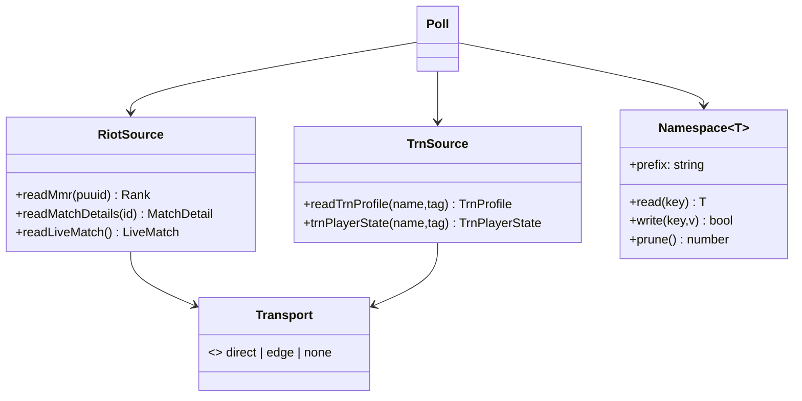

# Design — the data layer (buildable, no decisions left)

Implements `target.md` step 1–5. Every signature below is final; if a builder has to
choose something, this document is wrong. Replaces `tracker.ts:3794` (unvalidated MMR
parse), `tracker.ts:1740` (cross-module prune), `trn.ts:1028` (gate before transport).

## 1. File layout

```
src/model/types.ts        Player, Round, MatchDetail, Rank, TrnProfile, Validated<T>
src/cache/namespace.ts    createNamespace, writeLocalSafe, pruneAll, registry
src/cache/live.ts         const liveCache = createNamespace<LiveEntry>('live_player_stats', 3)
src/cache/rank.ts         const rankCache = createNamespace<Rank>('live_rank', 1)
src/cache/matches.ts      const matchCache = createNamespace<MatchDetail>('match', 7)
src/sources/riot.ts       readMmr, readMatchDetails, readLiveMatch, readPlayer24h
src/sources/trn.ts        readTrnProfile, readTrnMatches, trnPlayerState
src/transport.ts          chooseTransport, runGates
src/live/fill.ts          splitFillWaves, enqueueFill (absorbed from tracker.ts:2407)
src/live/poll.ts          pollLiveMatch (absorbed from tracker.ts:3700-4100)
```

Absorbed, not rewritten: `tracker.ts` keeps `parseLocalRank`, `parseRoundDetails`,
`mergeMmrRow` (pure) and loses every `localStorage` call to `cache/` and every
transport call to `sources/`.

## 2. Interfaces

```ts
// model/types.ts — the only thing a parser may accept.
declare const VALIDATED: unique symbol;
export type Validated<T> = T & { readonly [VALIDATED]: true };

export type Rank = { tier: number; rr: number; peakTier: number; peakSeasonId?: string;
                     at: number; stale: boolean };
export type TrnPrivacy = 'public' | 'private';

// sources/riot.ts — the raw transport is NOT exported. This is the whole point.
export function readMmr(puuid: string): Promise<Rank>;              // throws RiotError
export function readMatchDetails(matchId: string): Promise<MatchDetail>; // throws
export function readLiveMatch(): Promise<LiveMatch | null>;         // null = no match
export function readPlayer24h(puuid: string): Promise<{ won: number; lost: number }>;

// sources/trn.ts — a discriminated union, never a string to be substring-matched.
export type TrnError = { kind: 'missing' } | { kind: 'private' }
                     | { kind: 'rate-limited'; retryInMs: number }
                     | { kind: 'unavailable'; detail: string };
export function readTrnProfile(name: string, tag: string): Promise<TrnProfile>;
    // resolves with privacy parsed from metadata.privacy; rejects with TrnError
export function trnPlayerState(name: string, tag: string): TrnPlayerState; // sync, pure

// transport.ts — the transport is a VALUE with its gates attached.
export type Transport =
  | { kind: 'direct'; gates: readonly [] }
  | { kind: 'edge';   gates: readonly ['pause'] }
  | { kind: 'none';   reason: 'disabled' | 'no-route' };
export function chooseTransport(path: string): Transport;
export async function runGates(t: Transport): Promise<void>; // exhaustive switch

// cache/namespace.ts
export function writeLocalSafe(key: string, value: string): boolean; // never throws
export interface Namespace<T> {
  readonly prefix: string;                 // `recon_${name}_v${generation}`
  read(key: string): T | null;
  write(key: string, value: T): boolean;
  prune(): number;                         // only its own prefix
}
export function createNamespace<T>(name: string, generation: number): Namespace<T>;
export function pruneAll(): number;        // iterates the registry only
```



## 3. Ownership map

| prefix | owner (only place it is constructed) | generation constant |
| --- | --- | --- |
| `recon_live_player_stats_v3` | `cache/live.ts` | same file, `const GENERATION = 3` |
| `recon_live_rank_v1` | `cache/rank.ts` | same file |
| `recon_match_v7_*` | `cache/matches.ts` | same file |
| `recon_trn_negative_v2` | `sources/trn.ts` | same file |
| `recon_trn_cooldown_until_v1` | `sources/trn.ts` | same file |

**The rule, encoded:** a prefix is never a string literal outside its owner.
`createNamespace(name, generation)` derives the prefix and registers it in a
module-private registry; `pruneAll()` walks that registry. A module cannot prune a
key it did not construct, because it has no way to name it. Deleting a generation
means editing the constant in its owner file — the bump and the cleanup are the
same edit.

## 4. The three bug classes, made unrepresentable

**(a) guard skipped at one call site.** `riotGet` stops being exported
(today: `tracker.ts:694` guards, `:3794` forgot). `readMmr` is the only way to
obtain a rank payload, and it validates before returning; the parser's parameter is
`Validated<RiotMmrPayload>`, which nothing else can construct. A caller cannot skip
a check it cannot reach.

**(b) a cache generation that deletes itself.** Pruning is `Namespace.prune()`, an
instance method over a derived prefix. `pruneAll()` only sees registered namespaces.
The cross-module list at `tracker.ts:1740` has no equivalent to be written.

**(c) one transport's gate on another transport.** `Transport` carries its own
`gates` tuple, and `runGates` switches on `kind` exhaustively (a `never` arm makes
a new kind a compile error). The pause is unreachable for `direct` because it is
not in that variant's type — not because someone remembered to check first.

## 5. Migration order and acceptance

Each step ships alone and is green before the next starts.

1. **Boundaries.** Add `sources/riot.ts` with `readMmr`/`readMatchDetails`; stop
   exporting `riotGet`; port the two call sites. Accept: `bun run build:ui` +
   `scripts/*-check.ts` green, and a source assertion that `riotGet(` appears only
   inside `sources/riot.ts`.
2. **Cache ownership.** Add `cache/namespace.ts`, move the three live keys and both
   TRN keys behind namespaces, delete the prune list at `tracker.ts:1740`.
   Accept: assert `recon_` literals exist only in `src/cache/*` and
   `src/sources/trn.ts`; a simulated quota write returns `false` and never throws.
3. **Transport-first.** Add `transport.ts`, replace both `canServeDirect` sites
   (`trn.ts:287`, `:1028`). Accept: an assertion that `chooseTransport` is called
   before any gate; a paused+direct test proceeds.
4. **Split `tracker.ts`.** Move `pollLiveMatch` → `live/poll.ts`, fill → `live/fill.ts`,
   parsers → `model/parse.ts`. Pure moves. Accept: no behaviour diff in
   `scripts/live-poll-check.ts`, and `tracker.ts` under 800 lines.
5. **UI pass.** Views read only `model/` types. Accept: no component imports
   `sources/*` (grep assertion), and the four TS states render value / `no profile`
   / `private` / dash.

## 6. Deliberately NOT changed

- No new data source; TRN keeps only what Riot cannot answer (precomputed aggregates).
- No rewrite of pure helpers (`parseLocalRank`, `parseRoundDetails`, `mergeMmrRow`,
  `splitFillWaves`) — they move file and keep their bodies.
- No UI redesign beyond the four-state TS column.
- No change to the Rust commands, the direct transport's `source=overwolf-2`, or the
  negative TTLs.
- No test framework change: the acceptance checks are assertions in the existing
  `scripts/*-check.ts` files.
