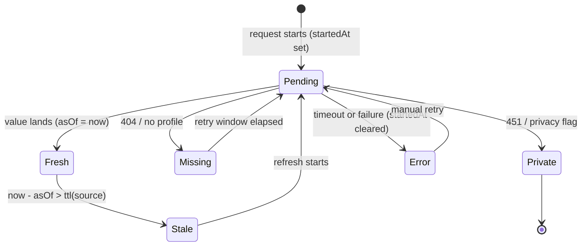

# Recon UI design — one state model, Riot-first, no unexpiring lies

Design for the rewrite. Read with `ui.md` (surfaces + honesty audit), `target.md` (layers,
"sources are evidence") and `data-sources.md` (Riot authoritative, Tracker legacy).
Rule of the design: **Riot-local is the base, Tracker is decoration, every pending state has a deadline.**

## 1. One state model

```ts
export type Source = 'riot' | 'snapshot' | 'tracker' | 'derived';
export type FieldState = 'fresh' | 'stale' | 'missing' | 'private' | 'error';

export type Field<T> = {
  value: T | null;        // the only thing a cell may print
  source: Source;         // where it came from, shown on hover/registry
  asOf: number | null;    // when the source observed it; null when no value
  state: FieldState;      // terminal verdict — never 'loading'
  startedAt?: number;     // set only while a request is open
};
```

`state` is *derived*, not assigned by views: value + age (`fresh` → `stale`), or a terminal
answer (`missing` = 404/no-page, `private` = 451/privacy flag, `error` = timeout/failure).
A request in flight is **not a state**: it is `value === null && startedAt != null`, rendered
as a placeholder, and it *must* become `error` at `startedAt + timeout(source)`. That one rule
removes "fetching forever" everywhere.



Timeouts/TTLs (one table, one owner): Riot live 5 s / 10 s timeout; Riot profile 5 min / 10 s;
local match details immutable per match (never stale); snapshot 24 h; Tracker 1 h / 12 s.
`Field<T>` lives in `src/model/field.ts`; `settle(field, now)` is the only mutator of `state`.

It replaces the three machines found in `ui.md`:
| Today | New |
|---|---|
| store flags `isLoading/ready/hasCached/clientClosed/riotClient` | `StoreHealth` (client lifecycle only) + one `Field` per datum |
| per-view `isLoading/error` in 9 files | view = composition of fields; skeleton only when every required field is pending; error only when all settled empty |
| per-row `trnState` / `trnPlayerState` | `profile: Field<TrackerProfile>` + one `Field` per stat; `missing`/`private`/`error` are field states, not icons chosen by CSS |

Rendering: one `<FieldView field>` is the only component allowed to show a stat. It owns the
value, the age stamp, the placeholder and the terminal copy; no view may format or hide a value
itself. `fresh` + `riot` prints just the value; `stale` prints value + `as of 3m`; pending prints
a static placeholder with the deadline; `missing` prints "no data"; `private` prints a lock; `error`
prints `unavailable` with a retry hint where clicking retry is possible.

## 2. The lobby board, redesigned

The board is a **Riot board with an optional Tracker appendix**. One row, one expandable section:

```
[agent] [Name#Tag + party] | [rank icon + RR] | [peak + act] | [Lvl] | [⌄]
  ⌄ Riot stats (local scan)   ACS/K-D/Win%/HS%  ·  scanning 3/20 …  ·  as of 2m
  ⌄ Tracker (archive)         ACS / K-D / Win% / HS%  ·  one stamp: as of 2 Nov
```

| Cell | Source | Fresh | Stale | Missing | Private | Error |
|---|---|---|---|---|---|---|
| Agent / name / party | riot | always printed | — | hidden name → "Hidden by Riot" | — | — |
| Rank + RR | riot (`mmr` any puuid) | icon + RR | icon + RR + `as of 5m` | `Unranked` only if Riot says tier 0; else `rank unavailable` | never locked | `rank unavailable` text, not a dash |
| Peak (+ act) | riot | icon + act | + `as of` | `—` + tooltip "Riot returned no peak" | never locked | `unavailable` |
| Level | riot identity | number | + `as of` | `—` (Riot omitted) | never locked | `unavailable` |
| Riot act stats (expanded) | derived from riot history | values + `as of` | values + `as of` | `not enough local matches` | never locked | `scan failed — retry` |
| Tracker stats (archive) | tracker | never fresh | value + `as of 2 Nov` | `no Tracker profile` | lock + `private` | `unavailable` (timeout at 12 s) |

Visual grammar — each meaning is legal in exactly one place:
- **Dash `—`**: only a *local* field the source explicitly returned empty; tooltip names the source.
  Never for Tracker, never while pending, never for "no profile".
- **Lock**: only a Tracker field whose own source reported privacy (451/privacy flag); tooltip
  "Private Tracker profile". Never on rank, level, party, or any Riot-local cell.
- **Pulsing dot**: banned in rows and cells. At most one, in the Tracker group header, while
  `startedAt` is live; it disappears at the 12 s timeout and is replaced by `Tracker unavailable`.
- **`as of 3m` / `as of 2 Nov`**: only on Tracker-derived values (and Riot values older than
  their TTL). Relative under 24 h, date older. A Tracker number without a stamp is a bug.

Sorting is local: rank tier then RR. Tracker values never sort the board; they live inside the
expanded appendix and their absence never changes row order. The appendix is collapsed by default
and remembers its state per window. A row whose Tracker data is `missing`/`private` still reads
as a complete player because every printed cell is local.

## 3. The overlay, same rules at a glance

- Mid-round the HUD prints only local fields: agent, name/party, rank, level. Nothing Tracker.
- An opt-in "Tracker (archive)" widget may be added in Settings; it renders only values carrying
  `asOf`, with one header line `TRN · 2 Nov`. If the newest Tracker `asOf` is older than 7 days,
  the widget hides itself and shows nothing — no "stale" tooltip during a match.
- Pending is never rendered in the overlay: `value === null` renders nothing, not a pulse; the 12 s
  timeout applies in the data layer, not as a visible state.
- Must never show: a per-cell pulse/spinner, the word "fetching", TS (retired), an unlabeled Tracker
  number, a lock on a local field, or the LIVE label unless the live phase says so.
- Edit mode may show empty slots with source labels; play mode shows only settled local fields.

## 4. Component plan

Split the four monsters; one component per state decision:
- `OverlayView` 2,810 → `HudCanvas`, `hud/PlayerRow` (one row, used by lobby/pregame/in-match),
  `hud/TeamBoard`, `hud/MetaTiles`, `hud/EditChrome`, `hud/useDrag`, `hud/overlayConfig`.
- `MatchDetailModal` 1,492 → `MatchDetailDialog` shell, `match/TeamTable` (one table rendered
  twice), `match/DuelsTab`, `match/RoundTimeline`, `match/PlayerDialog`; all stats via `FieldView`.
- `AppSettingsView` 1,221 → `settings/Updates`, `settings/Session`, `settings/Hud`, `settings/Display`,
  `settings/Data`, plus `settings/useUpdateFlow` and `settings/useOverlayPrefs`.
- `DevDashboard` stays dev-only; not part of the redraw budget.

Shared primitives (new `src/ui/`): `FieldView` (the only stat cell), `SourceStamp`, `StateLegend`,
`Badge` (replaces ScoreBadge + ad-hoc pills), `DataTable` (one sort/expand), `EmptyState`, `Skeleton`
(one, replaces `TrackerSkeletons`/`ViewSkeleton`/`TrackerMiniSkeleton`/inline spinners), `Modal`
(one dialog shell for four modals), `PageHeader`. Deleted outright: `trnState`, per-view loading
booleans, the per-cell dot/lock logic, and every inline `toFixed` formatter.

## 5. Acceptance for the judge — five screenshot checks

1. With Tracker OFF, every lobby row shows a Riot rank (or the word `Unranked`) and the Tracker appendix reads `Tracker · not available`; the screenshot contains no pulsing dot, no lock and no Tracker number.
2. With Tracker ON and dead, the expanded appendix shows one `as of 2 Nov` stamp and every cell is a value+stamp, `no Tracker profile`, `private`, or `unavailable`; no cell says "fetching".
3. A screenshot taken 15 s after opening a lobby shows no spinner or pulse anywhere, and the appendix reads `Tracker unavailable` (the request expired).
4. Opening an old cached match shows `cached · as of {date}` on every Tracker-sourced field, and any field older than 7 days is absent rather than a dash or a zero.
5. In the overlay, a private Tracker profile puts a lock only inside the Tracker-archive widget (never on rank/level), and with the archive disabled the HUD shows zero Tracker numbers.
