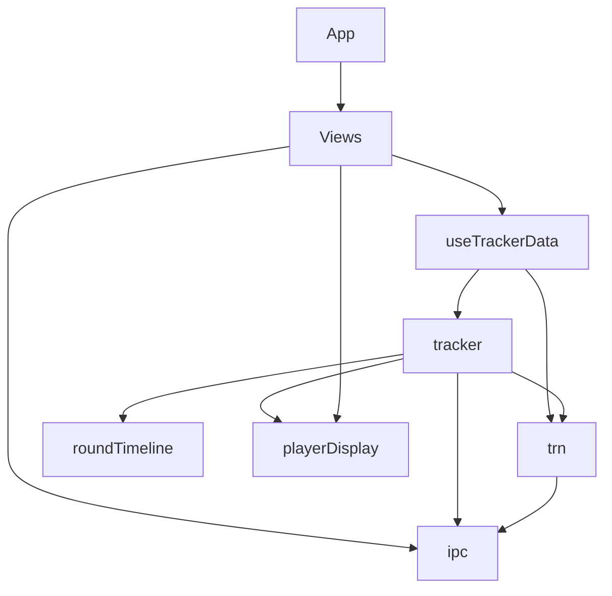
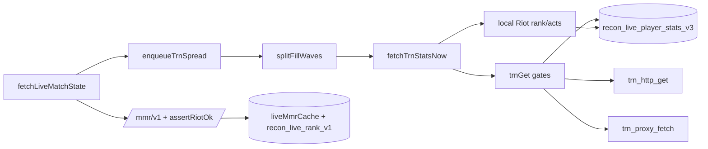

# Recon — frontend architecture (as built)

Read from source on branch `main`, 2026-11-09. Line counts are real. This describes
what the code *is*, not what it was meant to be.

## 1. Module map

**Shell / views** (`src/`, `src/components/`) — 35 components, one per tab plus the
overlay. Eager: `App.tsx` (602), `Sidebar`, `TopBar`, `TrackerView`, `OverlayView` (2810).
Lazy (9): Utility, ValorantConfig, AppSettings, Store, RiotChat, Crosshair, Prepick,
Accounts, DevDashboard. Views never fetch directly except modals.

**Hooks** (`src/hooks/`) — `useTrackerData.ts` (657): the store, the refresh loop and
the cross-realm broadcast. `useLiveMatchActive.ts`: poll-liveness. `useCountUp.ts`: UI only.

**Data / utils** (`src/utils/`, 26 files). The real architecture:

| file | lines | role |
| --- | ---: | --- |
| `tracker.ts` | 4358 | Riot-local client: MMR, match history, details, live match poll, caches, rank persistence, storage hygiene. **God module.** |
| `trn.ts` | 2220 | Tracker Network client: gate, transport selection, health, negatives, profile/act parsing. |
| `ipc.ts` | 882 | Every Tauri `invoke` wrapper + `isTauri()` + mock fallbacks. |
| `loadout.ts` | 680 | Weapon/skin catalogue and loadout parse. |
| `store.ts` | 529 | Daily shop (Riot storefront), independent of tracker. |
| `accountVideo.ts`, `accounts.ts` | ~500 | Per-account settings, account switching. |
| `roundTimeline.ts` | 230 | Pure metrics over `MatchRoundDetail[]`. |
| `actStats.ts` | 128 | Pure act aggregation (KD/ACS/win%). |
| `playerDisplay.ts` | 250 | Shared row formatting (flag, KD colour, tracker URLs). |
| `crosshair*.ts`, `prepick.ts`, `riotChat.ts`, `mapMeta.ts`, `blitzMeta.ts`, `matchServer.ts`, `perf.ts`, `ops.ts`, `updater.ts`, `logger.ts`, `consent.ts`, `tabRestore.ts`, `version.ts`, `format.ts`, `devTools.ts`, `trackerTips.ts` | small | single-purpose, mostly leaf modules |

## 2. Live-match data flow (the path that matters)

1. `LiveMatchView` / `OverlayView` call `fetchLiveMatchState()` every 3 s / 2.5 s.
2. `fetchLiveMatchStateInner` reads Riot-local presence + `core-game`/`pregame`, builds
   `LiveMatchState` (roster, teams, incognito, party ids).
3. Rank: `riotGet(shard, '/mmr/v1/players/{puuid}')` → **`assertRiotOk(j,'mmr')`** →
   `parseLocalRank(j, seasonOrder)` → `liveMmrCache` **and** `persistLiveRank()`.
4. TRN enrichment: `enqueueTrnSpread` → `splitFillWaves` (own 5, then theirs) →
   `fetchTrnStatsNow` → local Riot first (`fetchLocalRank`/`fetchLocalActStats`) →
   TRN fallback only if health is `ok`.
5. `trnGet` → file cache → gates → `canServeDirect(path)` chooses **direct**
   `invoke('trn_http_get')` or **edge** `invoke('trn_proxy_fetch')`.
6. Results merge into `LivePlayerStatsEntry` (`setCachedLivePlayerStats`) + `liveMmrCache`;
   both are persisted.
7. `mergeLiveMatchStateNonRegressing` + `mergeMmrRow` latch non-regressing values.
8. Views render `LiveMatchPlayer`.

## 3. Cache inventory

| key | owner | TTL | generation | invalidated by | readers |
| --- | --- | --- | --- | --- | --- |
| `recon_live_player_stats_v3` | tracker.ts | 24 h | v3 | matchId stamp mismatch (disk **and** memory), prune | tracker, hooks |
| `recon_live_rank_v1` | tracker.ts | session (200 cap) | v1 | none — deliberate last-known-good | tracker poll |
| `recon_match_v7_{id}` | tracker.ts | forever (immutable) | v7 | key bump, prune | MatchDetailModal |
| `recon_trn_negative_v2` | trn.ts | 24 h missing / 7 d private | v2 | expiry, prune | trn.ts, tracker fill |
| `recon_trn_cooldown_until_v1` | trn.ts | until epoch | v1 | success, reset | trn.ts |
| `recon_tracker_enabled_v1`, `recon_trn_http_enabled_v1` | trn.ts | none | v1 | user toggle | trn.ts, settings |
| `recon_trn_cache_v2` (files: disk, via Rust) | trn.ts | per-call `ttlMs` | v2 | Rust caps/age | trn.ts |
| `recon_tracker_snapshot_v1` | useTrackerData.ts | 24 h | v1 | refresh | hooks |
| `aspect_names_cache_v2`, `recon_weapon_catalog_v7`, `recon_store_v3` | tracker / loadout / store | long | mixed | none | own module |

**Cross-module ownership (the dangerous ones):** `src/utils/tracker.ts` **prunes**
`recon_trn_*` keys it does not own — the prune list at `pruneSupersededCaches()`
(1740) deletes `recon_trn_negative_v1` and `recon_trn_cache_v1` while `trn.ts` owns
both. Any future generation of those keys must be added to a list in a *different*
module, or it is never cleaned. That coupling is the single most fragile thing here.

## 4. Known slop, ranked by damage

1. **`tracker.ts` = 4358 lines** covering polling, three cache families, rank parsing,
   storage hygiene, party colours and match details. Every bug tonight lived here.
2. **Two ways to pick a transport.** `transportGet` decides direct-vs-edge *and*
   `canServeDirect` decides whether the pause applies — two call sites, one predicate.
   Before the fix they disagreed.
3. **Rank had two homes** — `liveMmrCache` and `LivePlayerStatsEntry` — and only one
   survived a rebuild.
4. **Dead exports still exported** for tests only (`TRN_SPREAD_REFILL_MS`,
   `parseTrnHttpEnabledFlag`…); 24 were deleted tonight, more remain as "seams".
5. **Two key-name generations in one file** (`recon_trn_cache_v1` + `_v2`, `v6` + `v7`)
   kept alive by the prune list.
6. `playerDisplay.ts` mixes formatting with URLs; `format.ts` overlaps it.

## 5. The three bug classes and the structural fix for each

**(a) A guard skipped at one call site.** `assertRiotOk` existed at `tracker.ts:694`
and the live-MMR call site at `:3794` did not call it, so a Riot error parsed into
`tier: 0` → ten rows of "Unrated".
*Fix that makes it impossible:* never hand a raw payload to a parser. Make
`parseLocalRank` accept only a validated value produced by a `readMmr()` that calls
`assertRiotOk` internally — a parser that cannot see an unchecked payload cannot skip
the check. Guards belong inside the boundary, not at each caller.

**(b) A cache generation that deletes itself.** `pruneSupersededCaches()` lives in
`tracker.ts` but deletes `recon_trn_*` keys owned by `trn.ts`; a new generation is
written by one module and cleaned by a list in another, and when storage is full the
write silently fails so the bump never lands.
*Fix:* each module owns and prunes its own namespace (`trn.ts` prunes `recon_trn_*`),
with one shared `writeLocalSafe` helper; a generation constant lives next to its data.

**(c) A gate written for one transport applied to another.** The fullscreen pause was
correct for the webview transport and wrong for the reqwest transport, and it was
applied before the transport was chosen (`trn.ts:1028` `canServeDirect` is the fix).
*Fix:* decide the transport first, then apply only that transport's gates — one
`chooseTransport(path)` result threaded through the gate chain, so a gate can never be
evaluated against a transport that will not run.
