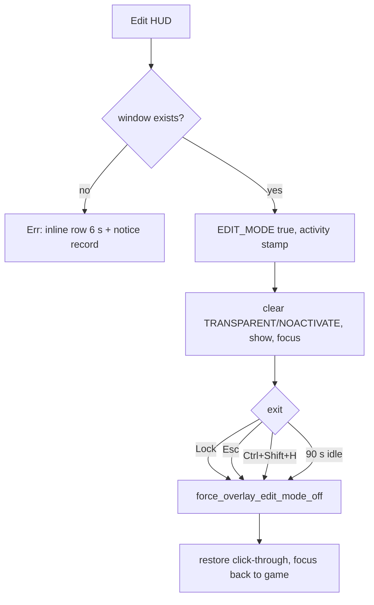

# Overlay runtime

One transparent, always-on-top WebView2 window pinned to the VALORANT rect.
Rust owns existence, geometry, visibility and input styles; the webview owns
pixels and decides when it has content worth compositing.

Code: `lib.rs` (creation, show/hide, edit mode, both daemons), `window_manager.rs`
(styles, subclass, activity clock), `OverlayView.tsx` (render gates, data).

## 1. Ownership and creation

- `"create": false` in `tauri.conf.json`: Tauri's startup loop does `.build()?`
  on config windows before `setup`, so a HUD failure there used to kill the whole
  app — zero windows, no dialog.
- `setup` builds it from the same entry inside a `match`: success sets
  `OVERLAY_AVAILABLE`, failure logs and the app runs without a HUD. It starts
  hidden, and only `show()`/`hide()` ever change that.

## 2. Input: click-through and edit mode

- Styles: `WS_POPUP`, `TOPMOST | TOOLWINDOW | NOACTIVATE`, no caption, no DWM
  border. Click-through is `WS_EX_TRANSPARENT` plus `WM_NCHITTEST ->
  HTTRANSPARENT` while edit mode is off. `WS_EX_LAYERED` is banned and unset.
- Edit mode clears `TRANSPARENT`/`NOACTIVATE`, shows, focuses, stamps the activity
  clock. Entry resolves the window **before** flipping the flag, so a missing HUD
  errors instead of arming edit mode from nowhere.
- Four exits via `force_overlay_edit_mode_off`: Lock, `Esc`, the guard's
  focus-free `Ctrl+Shift+H`, and 90 s without a mouse message.

## 3. The two threads

| Thread | Cadence | Does | Skips when |
|---|---|---|---|
| Overlay daemon | 2 s | show while VALORANT is foreground, hide when background/absent, re-align, heal lost click-through | `!OVERLAY_AVAILABLE` |
| Guard | 100 ms | exit chord, 90 s watchdog, Tab fast path (show only while Tab is down) | `!OVERLAY_AVAILABLE` |

Both start in `setup`; the Tab fast path is inert while `OVERLAY_PRESENT` is true.

## 4. Show / hide

```mermaid
sequenceDiagram
  participant D as 2 s daemon
  participant W as Overlay window
  Note over D: tick 2000 ms; exit early if !OVERLAY_AVAILABLE
  D->>D: valorant present and foreground?
  alt yes, and (UI has content or Tab held)
    D->>W: show_overlay - show, styles, align, heal
  else background or no game
    D->>W: hide_overlay
  end
  Note over W: gates change -> set_overlay_present(needed), 200 ms debounce
  opt present false and Tab held
    Note over D: guard shows in 100 ms, hides ~200 ms after release
  end
```

## 5. Edit-mode lifecycle



## 6. Data path and failures

| Shown | Source | Cadence |
|---|---|---|
| Phase, map, mode, teams, ranks, RR | Riot local API | 2.5 s visible; hidden skips; idle 1/12 (~30 s) |
| K/D, win %, HS %, ACS, tracker score | TRN — direct Rust HTTP first, hidden-webview transport as fallback | serial gate, ladder, per-lobby budget |
| Tab-peek board | local state + TRN cache | while Tab is held |

Cross-window refreshes arrive on `recon:live-match-sync`. Failures never
fabricate: Riot failure keeps the last state, TRN failure blanks a cell instead of
showing a zero. Warnings surface once — inline row, 6 s, plus one durable line in
`recon_overlay_notices_v1`.

## 7. Game interaction — what pauses, what must not

- Borderless required: exclusive fullscreen bypasses DWM, so the overlay shows,
  positions, and stays invisible — no warning today.
- Phase comes from the Riot local API, not window state; agent select also runs
  foreground, which is why show/hide is foreground-gated.
- The fullscreen pause is a **webview** pause: the edge transport evaluates JS in
  a hidden window, which must not run while VALORANT owns the screen. The direct
  transport is Rust HTTP — no webview, no stolen frames — so it must keep fetching
  during a match. Applying the webview pause to it left the live board empty for a
  whole match; `canServeDirect` bypasses the gate (`trn.ts:1019-1036`). Never
  re-order that pre-check above the transport choice. Residual: `tracker.ts:2526`
  still skips a fresh fill while paused even when every request would go direct.

## 8. Failure matrix

| Scenario | Expected | Actual |
|---|---|---|
| Overlay creation fails | app runs, HUD off, user told | app runs; tray "Show HUD" explains; daemons no-op |
| Game crashes or exits | HUD hides | hidden on the next 2 s tick |
| Resolution change | re-align | realigned within 2 s; widget offsets clamp into new bounds |
| Alt-tab out / back | hide, then return | each within 2 s (no foreground hook) |
| Webview dies during edit | edit mode exits, clicks pass through | `Esc` dead; chord or 90 s watchdog still exits |
| WebView2 runtime broken | visible error | startup MessageBox; HUD-only failure non-fatal |
| Edit mode on, game quits | must not trap clicks | watchdog/chord exits |

## 9. Frame cost and risks

1. A visible full-screen transparent window is composited every frame; the
   `set_overlay_present` gate keeps it off most of a match — keep it. Any
   `backdrop-filter` re-blurs the game every frame: banned, do not re-add.
2. The 2 s daemon runs `EnumWindows` twice per tick while visible — that is why
   show-after-alt-tab can lag 2 s. A foreground hook removes both.
