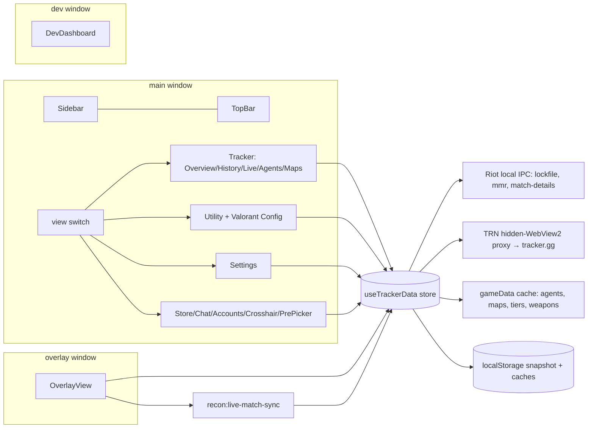

# Recon UI architecture — surfaces and state honesty

Read-only inventory for the redraw, 2026-11-09 (HEAD `ac6a6de` + working tree). No code changed.
Legend: ◐ = partly TRN · ○ = no TRN need. Data names are the store/IPC fields the view reads.

## 1. Window map

| Window | Renders | Shared | Window-specific |
|---|---|---|---|
| **main** (1210×800) | Sidebar, TopBar, one active view, global layers | TooltipHost, StatValue, ScoreBadge, ServerChip, ViewSkeleton, `format.ts`; ErrorBoundary sits at the React root for all windows | Sidebar, TopBar, all tracker/util views, modals |
| **overlay** (transparent, topmost) | OverlayView + OverlayCrosshair + TooltipHost | same store via `recon:tracker-trn`; live via `recon:live-match-sync` | overlay widgets, edit-mode chrome |
| **dev** (hidden window) | DevDashboard | store, logger ring | simulators, JSON inspector, perf meters |

Global layers in `App.tsx`: TooltipHost, ConsentModal (opened by the consent event), CrashOffer, OpsNotices (server JSON), TrnStatusBanner, toast (bottom-right), updater card (bottom-right), ViewErrorBoundary around the view switch.

## 2. View inventory

| View | Data dependencies | Empty / loading / error |
|---|---|---|
| Overview ◐ | store `profile, games, agg, trn, trnAgents, trnPrev, trnFetchedAt`; gameData | skeletons; RiotClientNotice (locked-out/crashed/not-running); cached-stats banner; archived-TRN banner (>7 d); per-act error strip |
| Match History ◐ | store `profile, games, detailsById, trnMatchTrs`; local match-details | skeleton; no-account card; filtered-empty + clear; `—` legend for missing detail; row opens MatchDetailModal |
| Live Match ◐ | `fetchLiveMatchState` poll; store `detailsById, trnMatchTrs, weapons`; live bus | waiting / agent-select / in-match / previous-match; per-row TRN state; "No players detected yet"; poll errors are silent |
| Agents ◐ | TRN act stats + local-match fallback | act-loading spinner; empty card says "play competitive or open Riot Client"; no age/error for TRN |
| Maps ◐ | same as Agents | same pattern |
| Store ○ | `getAccountStore(fetch)`, `getWallet` | loading skeleton; "Open Valorant…" / "Store unavailable"; 1 s countdowns from payload |
| Crosshair ○ | local client crosshair tables + local profile store | inline "Save failed — retry"; empty profile list |
| Pre-Picker ○ | local config + map meta | per-map empty copy; enabled/disabled switch |
| Riot Chat ○ | local Riot chat IPC | "Reading friends…", "No friends match that search", "No messages yet" |
| Accounts ○ | Rust account snapshots + local client | "No saved logins yet…"; inline per-action status |
| Resolution Switch ○ | `displayInfo/gpuInfo` from App IPC, shortcut | `isLoading` spinner; toasts for apply/errors |
| Stretch Preview / Setup / GPU Scaling ○ | same props / local config / `gpuInfo` | static previews; status text per section |
| Valorant Config ○ | local config-file IPC | per-tab status lines; inline errors |
| App Settings ○ | updater, autostart, monitors, overlay IPC, consent, logs | per-section status strings; confirm dialogs; dev-browser fallbacks |
| Dev Dashboard ○ | logger ring, perf IPC, simulators | dev-only; no loading states |
| Overlay HUD ◐ | store + live bus + overlay config | widgets simply hidden when no data; notices; no per-widget empty state |
| Player Overview modal ○ | local Riot act scan (`fetchLocalActStats`, `fetchMmrDirect`) + player prop from the board | loading; explicit fail copy (partial window hidden, timeout, incomplete) |
| Match Detail modal ○ | local match-details + `trnMatchTrs` | player/duel tables; TRS marked "(estimated)"; round timeline empty state for old cache |

No whole view dies without TRN any more (POM is local now). Thin-without-TRN *sections* are the rewrite candidates: Overview's Tracker Score + Previous Acts (TRN-only), the Agents/Maps primary tables (local fallback exists but is weaker), Live board TRN columns, MatchDetail TRS, and the overlay's Top Agents/map widgets.

## 3. Component slop, ranked by damage

1. **OverlayView.tsx — 2,810 lines.** Three near-duplicate player-row renderers (lobby, pregame, in-match), five inline-style walls, duplicated lock/dot/score cells. Highest drift risk: the in-game HUD is the surface users see while playing.
2. **MatchDetailModal.tsx — 1,492 lines.** Three hand-built player tables (`:658,801,1003`, plus a duel matrix at `:1248`) with the same 10 columns copied, plus duels + round timeline + nested player modal. One off-by-one already happened in the round strip.
3. **AppSettingsView.tsx — 1,221 lines.** Six sections (updates, startup, HUD, display, data, consent) in one file with five different status patterns (inline string, error, blocker, warning, toast).
4. **DevDashboard.tsx — 2,053 lines.** Sims + meters + log ring + JSON inspector in one component; dev-only, so damage is maintenance, not user-facing.
5. **Three state machines coexist:** store flags (`isLoading/ready/hasCached/clientClosed/riotClient`), per-view `isLoading/error` in 9 files, per-row `trnState`/`trnPlayerState`. Four skeleton flavours: `TrackerSkeletons` (505 lines), `ViewSkeleton`, `TrackerMiniSkeleton`, inline spinners.
6. **Agents/Maps tables — 749/717 lines, near-identical** sort/expand/empty/skeleton implementations; every fix must be made twice.
7. **Navigation chrome re-implemented per view:** Tracker/Utility/Modal tablists, Sidebar rail, page headers (h2 on five views, none on Store/Chat/Accounts/Crosshair), and the page-header pattern was copy-pasted.
8. **Five notification surfaces:** toast, updater card, Overview NoticeToast, TrnStatusBanner, OpsNotices. App's toast and updater card are two independent `fixed bottom-6 right-6` layers that can overlap, and Overview's NoticeToast is a third at the same corner.
9. **Formatting drift:** 60 `toFixed()` call sites remain outside `utils/format.ts`; K/D and % precision still varies by view.
10. **Modal shells:** four separate dialog/focus/Escape implementations (MatchDetail, PlayerOverview, LoadoutViewer, CustomResolution).

## 4. State-honesty audit — the theme

**A. "Fetching" that can never finish**
1. Overlay pending dot: `OverlayView.tsx:2645,2691` + `TRN_PENDING_TOOLTIP` ("Fetching tracker.gg stats…"). `trnState='pending'` is the default when no stats entry exists (`tracker.ts:4207`); if the TRN fill never runs (dead/rate-limited), the dot stays forever. LiveMatchView was fixed; the overlay was not.
2. `TrnStatusBanner.tsx:98` — "Stats will retry automatically in Ns". Retries happen; success does not (tracker.gg has served nothing since 2 Nov). A countdown implies progress the app cannot promise.
3. Overlay TS tooltip collapses four different situations into two labels (`OverlayView.tsx:2691`): pending says "Fetching tracker.gg stats…", everything else says "Tracker Score unavailable" — missing, private-but-unflagged, and never-read look identical.

**B. Stale numbers shown as current**
4. Only Overview carries a timestamp (`trnFetchedAt` + 7-day banner + card stamp, `Overview.tsx:157/256/362`). Every other TRN surface has no age: Agents/Maps tables, Live board ACS/K/D/Win/HS ("Act-wide…" tooltips), PlayerOverviewModal, MatchDetailModal real TRS, OverlayView Top Agents/TS/map stats.
5. `TrackerMini` rank/RR/peak comes from the cached sidebar mini; `savedAt` is written (`utils/tracker.ts:243`) but never read by the UI — a cached rank is shown as the live account.
6. `trnPlayerState 'ready'` only means "profile memo within TTL", not "fresh". LiveMatchView renders values with no age.
7. A failed refresh leaves last values visible and `isLoading` false; only `clientClosed/riotClient` produces a cached banner (`Overview.tsx:372`). There is no "as of" for a stale Riot-local read.
8. Store countdowns tick from a cached payload; `unavailable` is shown, but a stale successful payload has no "cached at" mark (`StorePanel.tsx:163-188`).

**C. Locks and statuses that overstate**
9. Overlay lock is `privLocked = p.isTrnPrivate === true` (`OverlayView.tsx:2351,2633`). Negative-registry entries expire (`utils/trn.ts`), so a lock can disappear (or linger) without the profile changing — a lock is not a freshness signal.
10. `TrnStatusBanner` says "Riot-direct data stays available meanwhile" without checking `riotClient`; if the client is logged out, that is false.
11. Good, keep: TopBar LIVE pill and Tracker dot share `useLiveMatchActive` (`hooks/useLiveMatchActive.ts`); overlay says LIVE only on `coregame`; no always-on live dot remains.
12. Good, keep: match rows with no detail render `—` + legend (no fake 0/0/0); missing vs private are distinct per-row states; Update card states "Checked at HH:MM"; TopBar says "Stats on/off", not "APIs ready".

## 5. Rules for the redraw

- One state model: `{ live, cached(asOf), fetching(startedAt), missing, private, error(reason) }`; every surface renders from it, never from ad-hoc booleans.
- Every cached/TRN-derived number carries `asOf`; no "as of" = not rendered. A pulse is allowed only with a started-at and a timeout.
- A lock means one thing only: the source itself reported privacy. Never infer it.
- Keep the window split and the shared primitives; replace the view shells, not the data layer.
